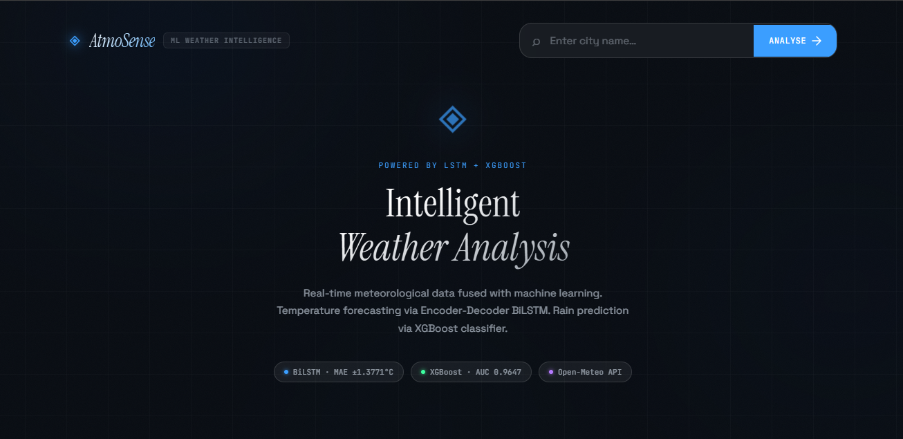
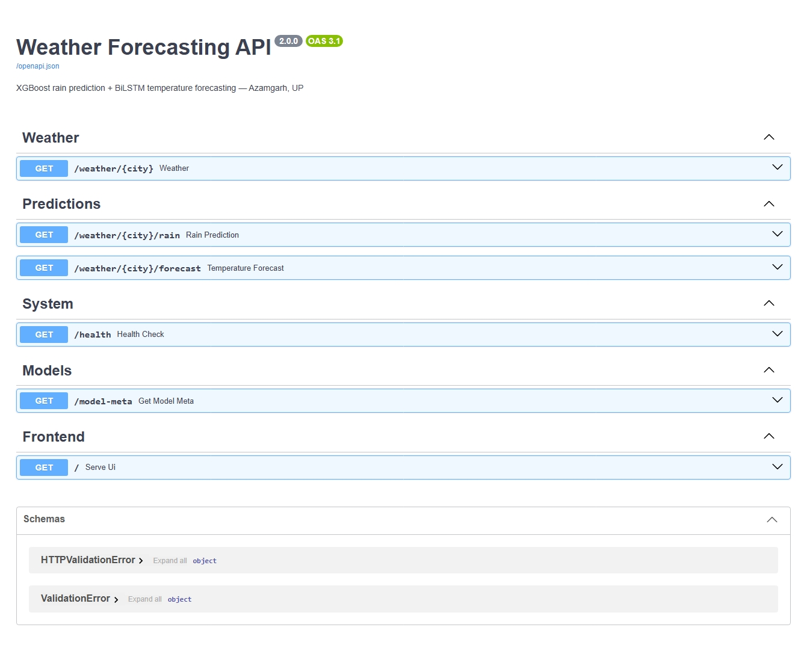
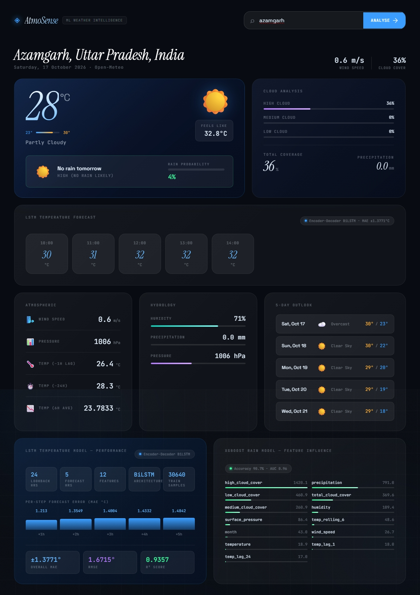
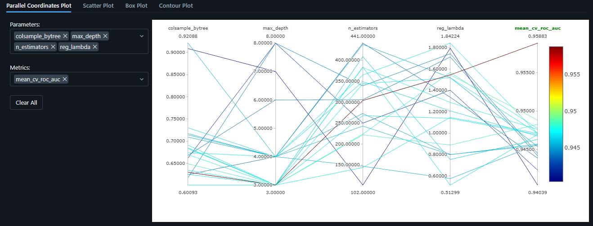
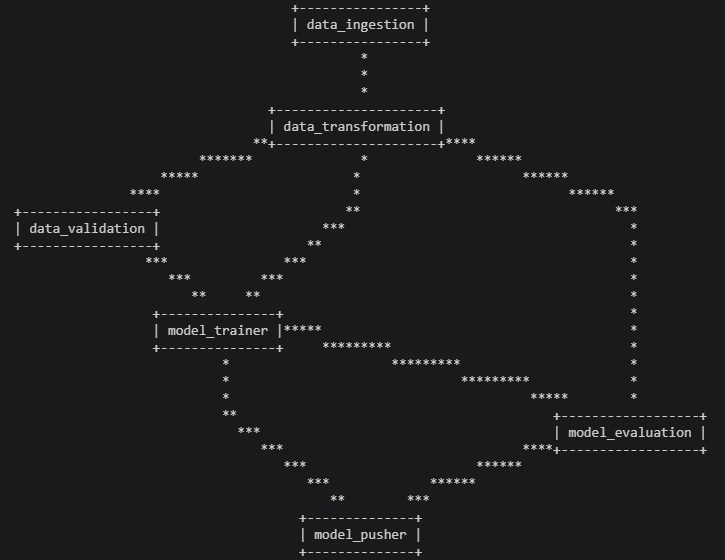
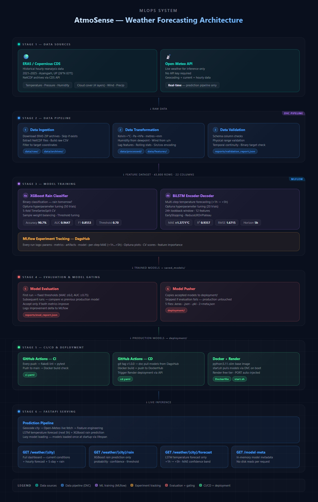

<p align="center">
  
</p>

<p align="center">
  End-to-end MLOps weather forecasting system — ERA5 data pipeline, XGBoost rain prediction, BiLSTM temperature forecasting, FastAPI, MLflow, DVC, and CI/CD on GitHub Actions.
</p>

<p align="center">
  
  
  
  
  
  
  
  
  
</p>

<p align="center">
  
  
  
</p>

---

## 📋 Table of Contents

- [Overview](#-overview)
- [Live Demo](#-live-demo)
- [Screenshots](#-screenshots)
- [Architecture](#️-architecture)
- [Features](#-features)
- [Tech Stack](#️-tech-stack)
- [Project Structure](#-project-structure)
- [Installation](#️-installation)
- [API Documentation](#-api-documentation)
- [Pipeline Overview](#-pipeline-overview)
- [MLflow Tracking](#-mlflow-tracking)
- [DVC Pipeline](#-dvc-pipeline)
- [CI/CD](#-cicd)
- [Deployment](#️-deployment)
- [Dataset](#-dataset)
- [Models & Performance](#-models--performance)
- [Roadmap](#-roadmap)
- [Contributing](#-contributing)
- [License](#-license)
- [Author](#-author)
- [Acknowledgements](#-acknowledgements)

---

## 📖 Overview

This project is a **production-grade MLOps Weather Forecasting System** that combines **Machine Learning**, **Deep Learning**, **experiment tracking**, and **pipeline versioning** to provide accurate rainfall predictions and short-term temperature forecasts for **Azamgarh, Uttar Pradesh, India (26.00°N, 83.00°E)**.

Historical weather observations are collected from the **ERA5 reanalysis dataset** provided by **ECMWF** via the Copernicus CDS API. Live weather conditions are retrieved in real time from the **Open-Meteo API**. The entire pipeline — from data ingestion through model training to deployment — is versioned, tracked and reproducible.

### 🎯 Prediction Tasks

| Forecast | Model | Task | Output |
|----------|-------|------|--------|
| 🌧️ Rain Prediction | XGBoost Classifier | Binary Classification | Rain probability + tomorrow's prediction |
| 🌡️ Temperature Forecast | BiLSTM Encoder-Decoder | Multi-step Time Series | Hourly temperature for next 5 hours |

### 🌍 Data Sources

- **ERA5 Reanalysis (ECMWF)** — historical hourly weather data (2021–2025) for model training
- **Open-Meteo API** — real-time weather observations for live inference (no API key required)

> **Why ERA5?**
> ERA5 provides high-quality, spatially consistent, gap-free weather observations including temperature, pressure, humidity, wind speed, and multi-layer cloud cover — ideal for ML-based forecasting.

### ✨ Key Features

- 🌦️ Real-time weather forecasting via Open-Meteo API
- 🤖 XGBoost rain classifier with Optuna hyperparameter tuning
- 🧠 BiLSTM Encoder-Decoder for multi-step temperature forecasting
- 📈 Advanced feature engineering — lag features, rolling stats, sin/cos cyclic encoding
- 🔄 Automated ERA5 data pipeline via Copernicus CDS API
- 📊 MLflow experiment tracking on DagsHub
- 🗂️ DVC pipeline and data versioning
- ⚡ FastAPI REST API with separate rain and forecast endpoints
- 🐳 Dockerized for consistent deployment
- 🚀 CI/CD with GitHub Actions → Render

---

## 🚀 Live Demo

| Service | URL |
|---------|-----|
| 🎨 **Live App** | [https://atmosense-weather-forecasting.onrender.com](https://atmosense-weather-forecasting.onrender.com) |
| 📖 **API Docs** | [/docs](https://atmosense-weather-forecasting.onrender.com/docs) · [/redoc](https://atmosense-weather-forecasting.onrender.com/redoc) |
| ⚡ **Health Check** | [/health](https://atmosense-weather-forecasting.onrender.com/health) |
| 📊 **MLflow UI** | [DagsHub Experiments](https://dagshub.com/Sharif-Abusad/weather-forecasting-system-mlops.mlflow) |

> **Note:** Hosted on Render's free tier — may take 30–60 seconds to wake up on first request.

---

## 📸 Screenshots

<details open>
<summary><b>🏠 Home — Weather Dashboard</b></summary>
<br/>
<p align="center">
  
</p>
</details>

<details>
<summary><b>📘 API Documentation — Swagger UI</b></summary>
<br/>
<p align="center">
  
</p>
</details>

<details>
<summary><b>🌦️ Weather Forecast — Temperature & Rain</b></summary>
<br/>
<p align="center">
  
</p>
</details>

<details>
<summary><b>📊 MLflow — Experiment Tracking</b></summary>
<br/>
<p align="center">
  
</p>
</details>

<details>
<summary><b>🗂️ DVC — Pipeline DAG</b></summary>
<br/>
<p align="center">
  
</p>
</details>

---

## 🏗️ Architecture

<details>
<summary><b>Full MLOps System Architecture</b></summary>
<br/>
<p align="center">
  
</p>
</details>

---

## ✨ Features

| | Feature | Description |
|---|---|---|
| 📥 | **Automated ERA5 Pipeline** | Monthly downloads via Copernicus CDS API |
| 🔧 | **Feature Engineering** | Lag features, rolling averages, sin/cos cyclic encodings |
| 📊 | **Comprehensive EDA** | 17 publication-quality figures across 11 analysis sections |
| 🌲 | **XGBoost Classifier** | Optuna tuning, TimeSeriesSplit CV, threshold optimization |
| 🧠 | **BiLSTM Encoder-Decoder** | 5-step temperature forecasting with ±MAE confidence |
| 📈 | **MLflow Tracking** | Every experiment logged to DagsHub — params, metrics, artifacts |
| 🗂️ | **DVC Pipeline** | Reproducible 6-stage pipeline with data and model versioning |
| 🌐 | **REST API** | Three separate endpoints — full dashboard, rain-only, forecast-only |
| 📡 | **Open-Meteo Integration** | Live inference with no database or API key required |
| 🐳 | **Docker** | Containerized for consistent local and cloud deployment |
| 🚀 | **CI/CD** | GitHub Actions — lint + test on push, build + deploy on tag |
| 🔁 | **Model Gating** | New models only pushed to production if better than previous |

---

## 🛠️ Tech Stack

### Backend
- **[FastAPI](https://fastapi.tiangolo.com)** — REST API framework
- **[Uvicorn](https://www.uvicorn.org)** — ASGI server
- **[python-dotenv](https://pypi.org/project/python-dotenv/)** — environment management

### Machine Learning
- **[XGBoost](https://xgboost.readthedocs.io/)** — rain prediction classifier
- **[TensorFlow / Keras](https://www.tensorflow.org/)** — BiLSTM temperature forecaster
- **[Scikit-learn](https://scikit-learn.org/)** — preprocessing and evaluation
- **[Optuna](https://optuna.org/)** — hyperparameter optimization

### MLOps
- **[MLflow](https://mlflow.org/)** — experiment tracking and model registry
- **[DVC](https://dvc.org/)** — pipeline and data versioning
- **[DagsHub](https://dagshub.com/)** — remote storage for DVC + MLflow UI
- **[GitHub Actions](https://github.com/features/actions)** — CI/CD
- **[Docker](https://www.docker.com/)** — containerization
- **[Render](https://render.com/)** — cloud deployment

### Data Processing
- **[Pandas](https://pandas.pydata.org/)** — data manipulation
- **[NumPy](https://numpy.org/)** — numerical computing
- **[xarray](https://xarray.pydata.org/)** — NetCDF file handling

### Data Sources
- **[ERA5](https://cds.climate.copernicus.eu/)** via **cdsapi** — historical training data
- **[Open-Meteo API](https://open-meteo.com/)** — live inference data

---

## 📂 Project Structure

```
weather-forecasting-system-mlops/
│
├── app/                              # FastAPI application
│   ├── routes/
│   │   └── weather_routes.py        # /weather, /weather/rain, /weather/forecast
│   ├── services/
│   │   ├── predictor.py             # model loading + inference
│   │   ├── weather_service.py       # live Open-Meteo feature fetch
│   │   ├── forecast_service.py      # 5-day forecast service
│   │   └── model_loader.py          # LSTM model loader
│   ├── utils/
│   │   └── weather_utils.py         # geocoding + humidity utils
│   ├── config.py                    # all paths and env config
│   └── main.py                      # FastAPI app with lifespan
│
├── src/                             # MLOps pipeline source
│   ├── components/
│   │   ├── data_ingestion.py        # ERA5 download + extract + build CSV
│   │   ├── data_transformation.py   # preprocess + feature engineering
│   │   ├── data_validation.py       # schema + range + continuity checks
│   │   ├── model_trainer.py         # orchestrator (XGBoost + LSTM)
│   │   ├── xgboost_trainer.py       # XGBoost training with CV + Optuna
│   │   ├── lstm_trainer.py          # BiLSTM training with callbacks
│   │   ├── model_evaluation.py      # metric comparison + acceptance gate
│   │   └── model_pusher.py          # copy accepted models to saved_models/
│   ├── pipeline/
│   │   ├── training_pipeline.py     # end-to-end 6-stage pipeline
│   │   └── prediction_pipeline.py   # live inference pipeline
│   ├── entity/
│   │   ├── config_entity.py         # stage config dataclasses
│   │   └── artifact_entity.py       # stage artifact dataclasses
│   ├── constants/__init__.py        # all project constants
│   ├── logger/__init__.py           # rotating file + console logger
│   ├── exception/__init__.py        # WeatherException with traceback
│   └── utils/main_utils.py          # yaml, json, joblib helpers
│
├── data/
│   ├── archives/                    # ERA5 zip downloads (DVC tracked)
│   ├── raw/                         # extracted NetCDF files (DVC tracked)
│   ├── processed/                   # weather_clean.csv (DVC tracked)
│   └── features/                    # weather_final.csv (DVC tracked)
│
├── saved_models/                    # Trained Models (current run)
│
├── deployment/                      # production models (DVC tracked)
│
├── artifact/                        # per-run timestamped artifacts
├── reports/                         # validation + eval reports
├── notebook/                        # EDA + experiment notebooks
│   ├── 01_eda.ipynb
│   ├── 03_xgboost_experiment.ipynb
│   └── 04_lstm_experiment.ipynb
│
├── static/                          # CSS + JS
├── templates/                       # index.html
├── config/
│   └── schema.yaml
│
├── .github/workflows/
│   ├── ci.yaml                      # lint + test on every push
│   └── cd.yaml                      # build + deploy on tag
│
├── dvc.yaml                         # 6-stage DVC pipeline
├── params.yaml                      # all hyperparameters
├── demo.py                          # local dev entry point
├── setup.py
├── requirements.txt
├── Dockerfile
├── .dockerignore
├── .env.example
├── .gitignore
├── dvc.lock
├── start.sh
├── README.md
└── template.py
```

---

## ⚙️ Installation

### Prerequisites

| Requirement | Version | Notes |
|---|---|---|
| Python | 3.11+ | |
| pip | 23.0+ | |
| CDS Account | Free | [Register here](https://cds.climate.copernicus.eu) |
| RAM | 8 GB+ | For LSTM training |
| GPU | Optional | CUDA 11.8+ for faster training |

### 1. Clone the repository

```bash
git clone https://github.com/sharif-abusad/weather-forecasting-system-mlops.git
cd weather-forecasting-system-mlops
```

### 2. Create and activate virtual environment

```bash
# Windows
python -m venv .venv
.venv\Scripts\activate

# Linux / Mac
python -m venv .venv
source .venv/bin/activate
```

### 3. Install dependencies

```bash
pip install -r requirements.txt
pip install -e .
```

### 4. Set up environment variables

```bash
cp .env.example .env
# Edit .env with your CDS API key and DagsHub token
```

### 5. Set up CDS API credentials

Create `~/.cdsapirc`:
```
url: https://cds.climate.copernicus.eu/api/v2
key: YOUR-UID:YOUR-API-KEY
```

> Get credentials from your [CDS profile page](https://cds.climate.copernicus.eu/user).

### 6. Pull data and models from DagsHub (recommended)

```bash
dvc pull
```

### 7. Or run the full training pipeline from scratch

```bash
python demo.py pipeline
```

### 8. Start the API

```bash
python demo.py api
```

Open `http://localhost:8000` in your browser.

---

## 📡 API Documentation

### `GET /weather/{city}`

Full dashboard — current weather, LSTM hourly forecast, XGBoost rain prediction, 5-day forecast.

```http
GET /weather/Azamgarh
```

```json
{
  "current": {
    "temperature": 33.4,
    "feels_like": 38.4,
    "humidity": 64.91,
    "surface_pressure": 985.7,
    "wind_speed": 15.4,
    "city": "Azamgarh, Uttar Pradesh, India"
  },
  "hourly": [
    { "time": "17:00", "temp": 31 },
    { "time": "18:00", "temp": 30 }
  ],
  "forecast": [
    { "date": "Mon, Oct 13", "temp_min": 24, "temp_max": 34, "description": "Partly cloudy", "icon": "03d" }
  ],
  "rain_prediction": {
    "rain_tomorrow": false,
    "probability": 0.1823,
    "confidence": "high (no rain likely)",
    "threshold_used": 0.7
  }
}
```

---

### `GET /weather/{city}/rain`

XGBoost rain prediction only.

```http
GET /weather/Azamgarh/rain
```

```json
{
  "city": "Azamgarh, Uttar Pradesh, India",
  "rain_prediction": {
    "rain_tomorrow": false,
    "probability": 0.1823,
    "confidence": "high (no rain likely)",
    "threshold_used": 0.7
  },
  "timestamp": "2026-10-13T09:25:37"
}
```

---

### `GET /weather/{city}/forecast`

BiLSTM temperature forecast only.

```http
GET /weather/Azamgarh/forecast
```

```json
{
  "city": "Azamgarh, Uttar Pradesh, India",
  "forecast": [
    { "time": "10:00", "hour": "+1h", "temperature_C": 31.24 },
    { "time": "11:00", "hour": "+2h", "temperature_C": 32.81 }
  ],
  "n_hours": 5,
  "mae_celsius": 5.1154,
  "model": "Encoder-Decoder BiLSTM",
  "timestamp": "2026-10-13T09:25:37"
}
```

---

### `GET /model-meta`

Returns in-memory metadata for both models — no file reads.

### `GET /health`

```json
{ "status": "ok", "models_loaded": true, "version": "2.0.0" }
```

### API Summary

| Method | Endpoint | Description |
|--------|----------|-------------|
| `GET` | `/weather/{city}` | Full dashboard data |
| `GET` | `/weather/{city}/rain` | Rain prediction only |
| `GET` | `/weather/{city}/forecast` | Temperature forecast only |
| `GET` | `/model-meta` | Model metadata (in-memory) |
| `GET` | `/health` | Health check |
| `GET` | `/` | Frontend dashboard |
| `GET` | `/docs` | Swagger UI |

---

## 🔄 Pipeline Overview

```
┌─────────────────────────────────────────────────────────┐
│                   TRAINING PIPELINE                     │
└─────────────────────────────────────────────────────────┘

           ┌──────────────────┐
           │  ERA5 CDS API    │
Trigger ▶ │ data_ingestion   │  downloads + extracts NetCDF → weather_raw.csv
           └────────┬─────────┘
                    ▼
           ┌──────────────────┐
           │ data_transform   │  ERA5 → °C, hPa, mm + lag/rolling/cyclic features
           └────────┬─────────┘
                    ▼
           ┌──────────────────┐
           │ data_validation  │  schema + range + temporal continuity checks
           └────────┬─────────┘
                    ▼
           ┌──────────────────┐
           │  model_trainer   │  XGBoost + BiLSTM (nested MLflow runs)
           └────────┬─────────┘
                    ▼
           ┌──────────────────┐
           │ model_evaluation │  compare vs previous model — accept if better
           └────────┬─────────┘
                    ▼
           ┌──────────────────┐
           │  model_pusher    │  copy accepted models → deployment/
           └──────────────────┘

┌─────────────────────────────────────────────────────────┐
│                  PREDICTION PIPELINE                    │
└─────────────────────────────────────────────────────────┘

  city name → geocode → Open-Meteo live fetch →
  feature engineering → LSTM forecast + XGBoost rain → JSON response
```

---

## 📊 MLflow Tracking

All experiments are tracked on **DagsHub**:

🔗 [dagshub.com/Sharif-Abusad/weather-forecasting-system-mlops.mlflow](https://dagshub.com/Sharif-Abusad/weather-forecasting-system-mlops.mlflow)

Every training run logs:

| Stage | What's logged |
|-------|---------------|
| `xgboost_rain` | params, AUC, F1, CV metrics, feature importance, model artifact |
| `lstm_temperature` | params, MAE, RMSE, R², per-step metrics (+1h to +5h), model artifact |
| `model_evaluation` | new vs previous metrics, improvement delta, acceptance decision |
| `xgboost_optuna_tuning` | best params, best CV AUC, Optuna plots |
| `lstm_optuna_tuning` | best params, best val_loss, Optuna plots |

---

## 🗂️ DVC Pipeline

```bash
dvc repro        # run full pipeline (skips unchanged stages)
dvc dag          # visualize pipeline DAG
dvc params diff  # see what params changed
dvc metrics show # show all tracked metrics
dvc push         # push data + models to DagsHub remote
dvc pull         # restore data + models from DagsHub
```

DVC tracks: `data/raw`, `data/processed`, `data/features`, `deployment/`

---

## 🚀 CI/CD

### CI — runs on every push

```
push to any branch
  └── lint (flake8 — errors only)
  └── tests (pytest)
  └── docker build check (main branch only)
```

### CD — runs on release tag

```
git tag v1.0.0 && git push origin v1.0.0
  └── dvc pull (models from DagsHub)
  └── docker build + push to DockerHub
  └── trigger Render deployment via API
```

### Required GitHub Secrets

| Secret | Description |
|--------|-------------|
| `DAGSHUB_USER` | DagsHub username |
| `DAGSHUB_TOKEN` | DagsHub access token |
| `DOCKERHUB_USERNAME` | DockerHub username |
| `DOCKERHUB_TOKEN` | DockerHub access token |
| `RENDER_API_KEY` | Render API key |
| `RENDER_SERVICE_ID` | Render service ID (`srv-xxxxx`) |

---

## ☁️ Deployment

### Docker

```bash
docker build -t weather-forecast-mlops .
docker run -p 8000:8000 \
  -v $(pwd)/saved_models:/app/saved_models \
  weather-forecast-mlops
```

### Render

1. Create a **Web Service** from this repository
2. Build command: `pip install -r requirements.txt && pip install -e .`
3. Start command: `uvicorn app.main:app --host 0.0.0.0 --port $PORT`
4. Add environment variables from `.env.example`
5. Deploy — or use the CD workflow to auto-deploy on tag

> Models are pulled from DagsHub via DVC during the CD pipeline before building the Docker image. No model files need to be committed to git.

---

## 📊 Dataset

| Property | Value |
|---|---|
| **Source** | ERA5 Reanalysis (ECMWF) via Copernicus CDS |
| **Location** | Azamgarh, UP, India (26.00°N, 83.00°E) |
| **Period** | January 2021 – December 2025 |
| **Frequency** | Hourly |
| **Total rows** | ~43,800 |
| **Features** | 22 columns after feature engineering |
| **Missing values** | None |
| **Format** | NetCDF → CSV |

### Feature Descriptions

| Column | Unit | Description |
|--------|------|-------------|
| `valid_time` | DateTime | Hourly timestamp (IST, UTC+5:30) |
| `temperature` | °C | Air temperature at 2m |
| `surface_pressure` | hPa | Atmospheric pressure |
| `total_cloud_cover` | 0–1 | Total cloud fraction |
| `low_cloud_cover` | 0–1 | Cloud fraction below 2 km |
| `medium_cloud_cover` | 0–1 | Cloud fraction 2–6 km |
| `high_cloud_cover` | 0–1 | Cloud fraction above 6 km |
| `precipitation` | mm | Hourly accumulated precipitation |
| `humidity` | % | Relative humidity at 2m |
| `wind_speed` | m/s | Wind speed at 10m |
| `temp_lag_1` | °C | Temperature 1 hour ago (autocorr ~0.99) |
| `temp_lag_24` | °C | Temperature 24 hours ago (autocorr ~0.85) |
| `temp_rolling_6` | °C | 6-hour rolling mean temperature |
| `hour_sin / hour_cos` | — | Cyclic hour encoding |
| `month_sin / month_cos` | — | Cyclic month encoding |
| `rain_tomorrow` | 0/1 | **Target**: rain in next 24h > 1mm |

---

## 🤖 Models & Performance

### XGBoost Rain Classifier

| Parameter | Value |
|---|---|
| `n_estimators` | Optuna tuned |
| `max_depth` | Optuna tuned |
| `learning_rate` | Optuna tuned |
| `subsample` | Optuna tuned |
| `eval_metric` | logloss |
| `early_stopping_rounds` | 20 |
| `class imbalance` | sample_weight='balanced' |
| `validation` | 5-fold TimeSeriesSplit |

| Metric | Value |
|---|---|
| ROC-AUC | `0.9647` |
| F1-Score (tuned) | `0.8553` |
| Accuracy (tuned) | `0.9072` |
| Avg Precision | `0.9292` |
| Best Threshold | `0.70` |
| CV ROC-AUC | `0.9337 ± 0.0359` |

### BiLSTM Encoder-Decoder

| Parameter | Value |
|---|---|
| Architecture | Encoder-Decoder BiLSTM |
| Lookback | 24 hours |
| Forecast horizon | 5 hours |
| Loss | Huber |
| Optimizer | Adam |
| Features | 12 (temp, lags, pressure, cloud, humidity, wind, cyclic) |

| Horizon | MAE (°C) |
|---------|----------|
| +1h | `1.2130` |
| +2h | `1.3549` |
| +3h | `1.4004` |
| +4h | `1.4332` |
| +5h | `1.4842` |
| **Overall** | **`1.3771`** |

---

## 🗺 Roadmap

- [x] ERA5 data pipeline (monthly downloads)
- [x] Feature engineering (lags, rolling, sin/cos encoding)
- [x] EDA notebook (17 figures, 11 analysis sections)
- [x] XGBoost classifier with Optuna tuning + threshold optimization
- [x] BiLSTM encoder-decoder temperature forecasting
- [x] FastAPI REST API with 3 separate endpoints
- [x] MLflow experiment tracking on DagsHub
- [x] DVC pipeline and data versioning
- [x] Model gating — push only if better than previous
- [x] Docker containerization
- [x] CI/CD with GitHub Actions → Render
- [ ] Extend LSTM forecast horizon to 24 hours
- [ ] Add precipitation amount regression model
- [ ] Multi-location support across eastern UP
- [ ] Compare against Transformer-based model (PatchTST)
- [ ] Automated daily retraining via GitHub Actions schedule

---

## 🤝 Contributing

Contributions are welcome.

1. Fork the repository
2. Create a feature branch: `git checkout -b feature/your-feature`
3. Commit: `git commit -m "Add: your feature"`
4. Push: `git push origin feature/your-feature`
5. Open a Pull Request

---

## 📄 License

This project is licensed under the **MIT License**.

---

## 👤 Author

<div align="center">

**Sharif Abusad**

[](https://github.com/sharif-abusad)
[](https://linkedin.com/in/sharif-abusad)
[](https://dagshub.com/Sharif-Abusad)

*If you found this project useful, consider giving it a ⭐ on GitHub!*

</div>

---

## 🙏 Acknowledgements

- **ECMWF / Copernicus** — for ERA5 reanalysis data via the [Climate Data Store](https://cds.climate.copernicus.eu)
- **Open-Meteo** — for the free, no-key-required weather API
- **DagsHub** — for free MLflow tracking and DVC remote storage
- **XGBoost team** — Chen & Guestrin (2016)
- **TensorFlow / Keras team** — for the deep learning framework
- **Optuna team** — for the hyperparameter optimization framework
- **DVC team** — for pipeline and data versioning

---

<p align="center">
Made with ❤️ for Azamgarh, UP, India<br>
⭐ If this project helped you, please give it a star!
</p>